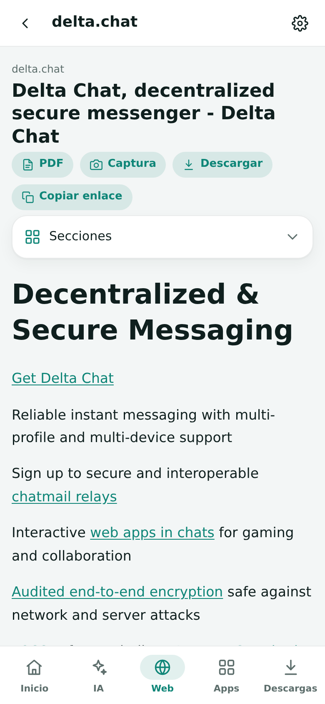
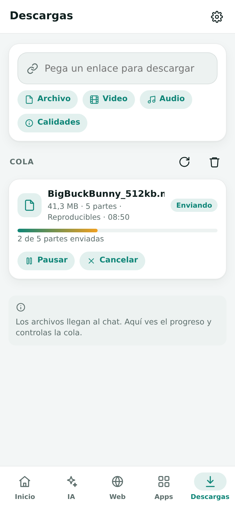
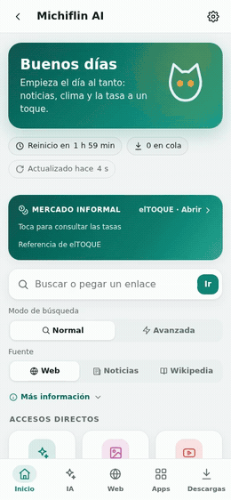
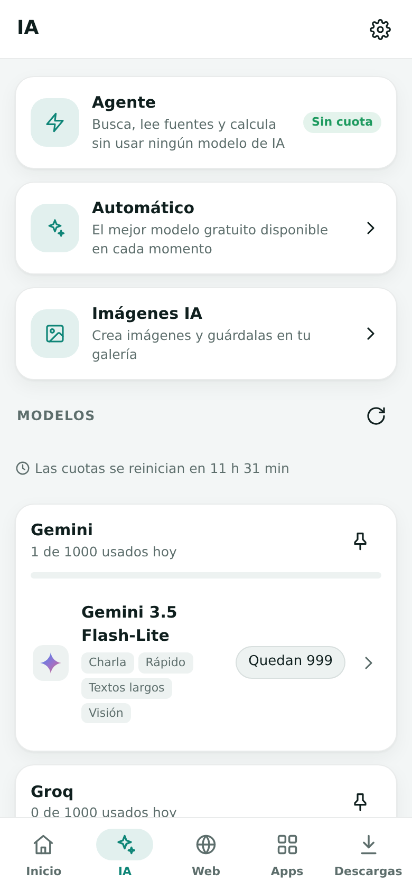
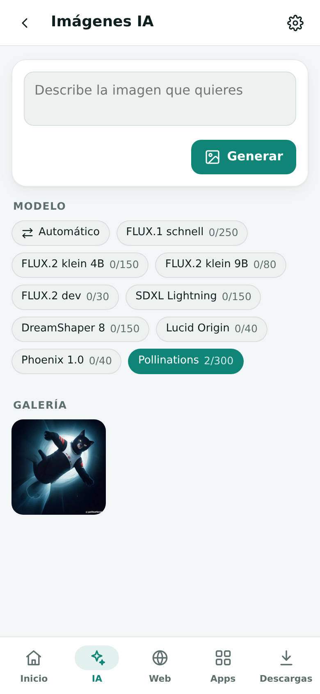
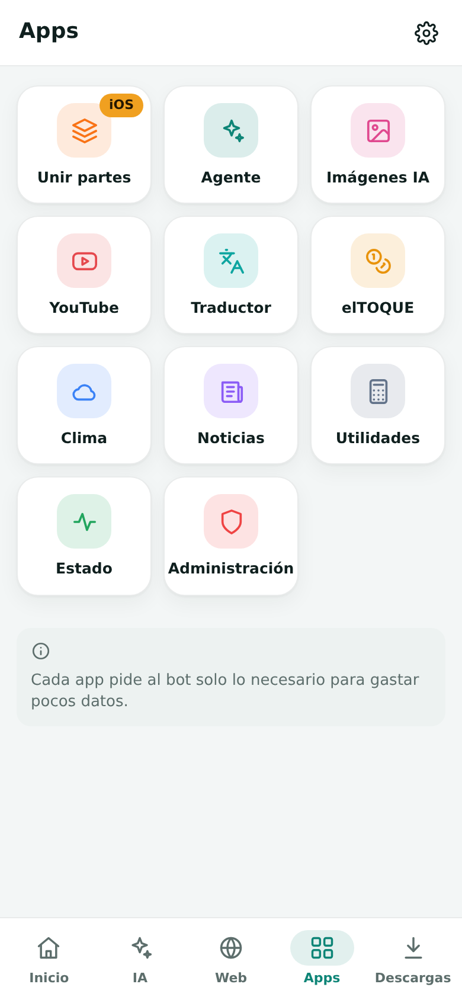
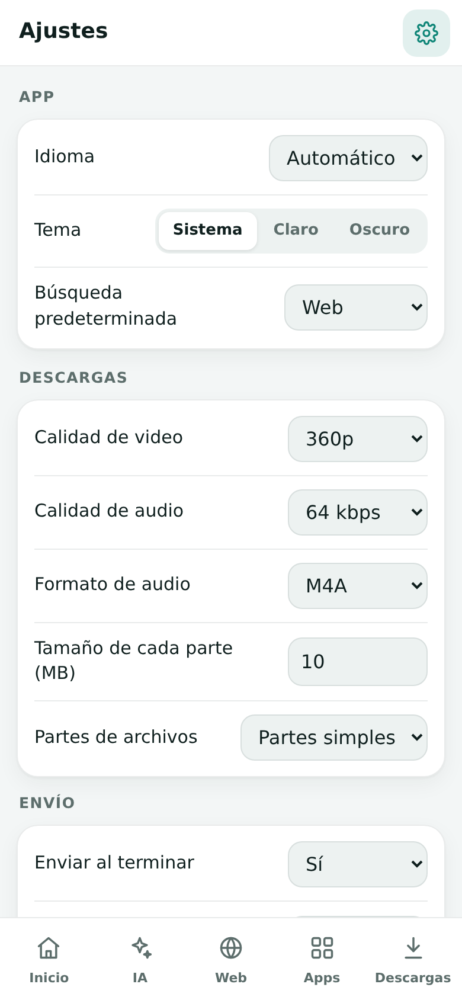

# Michiflin AI (español)

**Tu internet por correo.** Michiflin AI es un bot privado de [Delta Chat](https://delta.chat) que busca, lee páginas web, responde con modelos de IA gratuitos, crea imágenes y descarga archivos, y lo entrega todo como mensajes pequeños en el chat. Está pensado para buzones con poca cuota y conexiones lentas y caras.

Este documento es un anexo breve. La documentación completa está en inglés: [README](README.md) y [guía de uso](docs/GUIDE.md).

  
  
  
  

## Qué ofrece

- **Una miniapp para todo.** El bot envía una app WebXDC en el primer contacto, con una bienvenida que explica cómo usarla, y todo se hace ahí: inicio, IA, web, apps, descargas y ajustes. La primera vez que se abre muestra una introducción breve. Al chat solo llegan los archivos y medios entregados.
- **Un agente que no necesita IA.** Escribe normal o pega un enlace; el agente busca, lee las fuentes y arma la respuesta con frases citadas, además de calculadora, clima, tasas, traducción y resúmenes. Nunca llama a un modelo de IA, así que no toca ninguna cuota.
- **Agente de investigación con IA y límites.** Un agente opcional planifica hasta cuatro pasos con búsqueda pública, lectura, clima y cálculo. Usa cuota de IA, trata las páginas como datos no confiables y no dispone de terminal, inicio de sesión privado, mensajes ni herramientas de escritura.
- **IA gratuita mediante proveedores remotos.** Reparte las consultas entre planes gratuitos, con cuotas por modelo y relevo automático. Incluye SambaNova opcional; sus topes publicados para el nivel gratuito se registran de forma conservadora y pueden cambiar ([detalle y fuentes](docs/AI_PROVIDERS.md)). Cada modelo en pausa dice por qué: límite alcanzado, clave rechazada o ya no es gratis, y el bot avisa cuando un modelo se detiene o vuelve. Puedes elegir el modelo exacto de cada imagen. Cada chat de modelo muestra el logo de su creador y acepta los adjuntos que ese modelo puede leer: fotos, PDF y documentos, y audio en Gemini.
- **Navegación ligera.** Las páginas llegan como texto compacto con enlaces que se tocan. PDF y capturas nítidas a pedido. Búsqueda en la web, noticias, videos o Wikipedia con el buscador normal (sin límites), o cambia la barra al buscador avanzado cuando necesites mejores resultados.
- **Descargas para planes de datos por correo.** Videos, audios y archivos se dividen en partes: 10 MB por defecto para `@nauta.cu` y 20 MB para las demás direcciones; si el proveedor rechaza explícitamente el tamaño antes de entregar cualquier parte, el bot reintenta con partes menores. Los enlaces multimedia usan los extractores de yt-dlp para muchos sitios además de YouTube y enlaces directos; la cobertura varía según la fuente y no se promete descargar contenido privado o con DRM. Las partes de video y audio se reproducen solas; las demás son partes numeradas con huella SHA-256. Se pueden configurar límites verificados más estrictos por buzón. Los archivos `.xdc` llegan como miniapps que se abren en el chat.
- **Cola privada.** El despliegue de producción empieza solo para el dueño, quien puede autorizar invitados concretos temporalmente. Las entradas antiguas de acceso y uso pueden permanecer en el estado cifrado, pero no autorizan a otras personas ni se borran automáticamente.
- **Unir partes en cualquier teléfono.** Una herramienta integrada ordena las partes sola, aunque el teléfono les cambie el nombre, las verifica y las une, incluidos los segmentos de video y audio en un solo archivo reproducible.
- **Programador.** Describe un programa o una página web; los modelos gratis de código escriben archivos, comprueban automáticamente la sintaxis de Python y, si hay sandbox, JavaScript y C/C++; compilan Java si está disponible `javac`; ejecutan pruebas permitidas en un entorno aislado sin internet ni claves y corrigen errores. Revisa el diff por archivo y deshaz el último cambio del proyecto desde la app. Prueba las páginas dentro de la app y exporta las mini apps de Delta Chat como archivos `.xdc` listos para abrir y con el nombre del proyecto (o el código en ZIP). Si solo le preguntas algo, responde sin programar.
- **Útil sin IA.** Traductor, conversor de unidades, hora local, clima, titulares, tasa informal y calculadora.
- **Privado.** Empieza solo para el dueño; únicamente él puede autorizar invitados temporales. Los remitentes desconocidos se bloquean sin respuesta. Las notas, los enlaces en cola, los metadatos y algunos archivos temporales pueden conservarse. Los proveedores de IA reciben las consultas; no incluyas contraseñas ni claves privadas. El navegador Live permite intentar un inicio de sesión por sitio y guardar la sesión cifrada por persona si se solicita explícitamente; esto no garantiza que el proveedor acepte el navegador ni el acceso. Las conexiones oficiales antiguas pueden conservarse en copias cifradas aunque ya no tengan tarjetas en la interfaz. Las cookies globales de `yt-dlp` son solo para administración. Consulta el [alcance de acceso web](docs/WEB_ACCESS.md).
- **Administración.** Un panel en vivo muestra CPU, memoria, disco, red, tiempos de respuesta, la cola y la sesión del servidor, ejecuta una prueba de rendimiento acotada y muestra el uso del dueño sin activar ni borrar registros históricos ajenos.

## La miniapp

  
  

Recorrido (<a href="docs/media/es/clip-tour.mp4">MP4</a>) · Buscar y leer (<a href="docs/media/es/clip-web.mp4">MP4</a>)

| Pestaña | Para qué sirve |
|---|---|
| **Inicio** | Buscador, accesos directos, estado de la cola y tiempo hasta el próximo reinicio |
| **IA** | Agente, rotación automática, estudio de imágenes y un chat por modelo con usos restantes |
| **Web** | Resultados del buscador elegido, lector, historial, PDF, captura y descarga |
| **Apps** | YouTube, traductor, tasa, clima, noticias, utilidades, estado y administración |
| **Descargas** | Cola de archivos y sección de enlaces guardados con lector, captura y descarga |
| **Ajustes** | Idioma, tema, buscador, modo Nauta, Kill switch, ajustes del bot y borrado de datos del dispositivo |

  
  
  
  

## Descargas y unir partes

  
  

Descarga (<a href="docs/media/es/clip-download.mp4">MP4</a>, acelerado) · Unir partes (<a href="docs/media/es/clip-join.mp4">MP4</a>)

- Los videos y audios largos llegan como segmentos `Película (1-5).mp4`; cada uno se reproduce solo y lleva su número dentro.
- Los demás archivos llegan como partes `.001`, `.002`…; la última trae la huella SHA-256 del archivo completo.
- En iPhone y iPad, **Unir partes** las ordena, las junta, comprueba la huella y exporta el archivo a la galería, Archivos u otro chat. Los segmentos MP4, M4A y MP3 se unen en un solo archivo reproducible.
- Guarda las partes en **Archivos**, no en Fotos: Fotos les cambia el nombre y puede recodificarlas.

## Uso del chat

Por defecto todo funciona **solo desde la miniapp**: lo que se escriba en el chat recibe una respuesta corta que apunta a la app, y `/app` envía una copia nueva. Las notas de voz, fotos y documentos enviados al chat se siguen procesando.

El ajuste **Uso del chat** → *App y comandos* activa el modo clásico, con comandos en español e inglés (`/ayuda`, `/web`, `/buscar`, `/bajar`, `/ia`, `/traducir`, `/clima`, `/tasa`, `/ajustes`…). La lista completa está en la [guía](docs/GUIDE.md#classic-chat-mode).

## Instalación

La configuración y la puesta en marcha se describen en el [README](README.md#configuration). En producción, `OWNER_ONLY=1` exige `OWNER_ADDRESS` y comienza cerrado a otras direcciones, aunque figuren en listas antiguas. Las claves de IA son opcionales. La IA usa proveedores remotos, que reciben las consultas y el código; no incluyas contraseñas ni claves privadas.

## Control del acceso

En **Administración → Control de acceso · OWNER_ONLY**, el dueño puede abrir una sesión por 15 minutos, 1, 4 o 24 horas, o hasta el reinicio. La apertura exige confirmación y **no autoriza a nadie por sí sola**: hay que aprobar cada dirección y se puede revocar individualmente. Al cerrar o vencer, los trabajos pendientes de invitados se bloquean sin borrar datos históricos. Una entrega ya pasada al core de correo podría completarse.

También puede consultar `/solo_dueno`, cerrar con `/solo_dueno 1` o solicitar una apertura con `/solo_dueno 0 15`; el código de confirmación vence a los cinco minutos. `/admin_permitir` y `/admin_quitar` actúan sobre una dirección concreta. Los permisos viven solo en memoria: al reiniciar vuelve el valor configurado del entorno; con `OWNER_ONLY=1`, se vuelve al acceso del dueño. Mantenimiento prevalece y no permite abrir invitados. La respuesta visual puede demorarse porque viaja por correo; los invitados deben solicitar una miniapp nueva al ser reautorizados.

## Seguridad y pausa

El dueño puede activar **Mantenimiento y aviso** en Administración, personalizar el aviso en español e inglés y desactivarlo al terminar. Las tareas se detienen de forma cooperativa; las personas autorizadas reciben el aviso y la cola puede continuar, sin cambiar permisos ni pausas individuales. Una solicitud, cobro o entrega ya iniciados pueden terminar. Al actualizar la miniapp se conserva la anterior, aunque quede invalidada: su almacenamiento es independiente y todavía no se ha demostrado la migración de proyectos.

En **Apps → Kill switch** o con `/kill_switch sí|no` se bloquean nuevas solicitudes y se interrumpen cooperativamente descargas y empaquetado; los trabajos quedan en cola. Al desactivar, la cola puede continuar, pero hay que repetir las consultas de IA/agente interrumpidas. No se puede retirar una petición ya enviada a un proveedor, una lectura de red puede tardar hasta su timeout y una parte que ya entra en la entrega a Delta Chat puede llegar. Se registra la intención de envío y, ante una entrega incierta, se pausa en vez de reenviar a ciegas. Una copia de seguridad desactualizada o una interrupción del transporte impiden garantizar ausencia absoluta de duplicados: revisa el chat antes de repetir. No se purga el buzón de salida ni el estado histórico automáticamente.

**Mis APIs y modelos** permite a cada persona autorizada registrar y elegir explícitamente un proveedor propio. La clave se cifra antes del envío en clientes compatibles y se guarda cifrada por usuario, usando `WEB_SESSION_KEY` estable. El servidor elegido recibe la clave y las consultas y puede cobrar; descubrir un modelo no demuestra que todas sus capacidades funcionen. La pérdida o rotación de la clave maestra impide leer la bóveda anterior si no se dispone de una copia y la clave originales.

`NAUTA_STRICT=1` fija un máximo de 10 MB por parte sin elevar límites verificados inferiores. `KILL_SWITCH` y `NAUTA_STRICT` son valores iniciales: prevalece el estado guardado. El respaldo cifrado puede contener metadatos, notas y copias pequeñas de adjuntos; trátalo como sensible.

## Hospedaje temporal y copias

El despliegue actual en GitHub Actions es **temporal**: usarlo como servidor permanente puede llevar a restricciones o suspensión. El workflow se detiene si falta el respaldo establecido. Las nuevas copias cifradas se verifican en assets privados, sin acumular commits, y se rotan con varias versiones recientes, diarias y semanales solo tras verificar dos copias. Los adjuntos mayores de 200 KB y los parciales de `/tmp/michiflin-queue` quedan fuera: no es un archivo completo y el cambio de corredor puede perder bytes y progreso. La copia periódica se intenta cada 30 minutos y puede ser más antigua si falla. GitHub controla la liberación física de objetos antiguos. Consulta [mantenimiento y recuperación](docs/BACKUP_MAINTENANCE.md).

## Manual del propietario

La [guía integral en PDF](docs/Manual_Michiflin.pdf) explica el uso, el código, los límites y la migración. Para regenerarla desde el código fuente se necesitan las fuentes DejaVu instaladas y `pip install -r docs/requirements-manual.txt`; después, ejecuta `python tools/build_manual.py`. Las capturas incluidas en esa guía usan datos sintéticos y están identificadas como reales o simuladas.

## Licencia

Todos los derechos reservados. El código se publica solo para leerlo y aprender; ejecutarlo para otras personas o redistribuirlo requiere permiso. Consulta [LICENSE](LICENSE).
