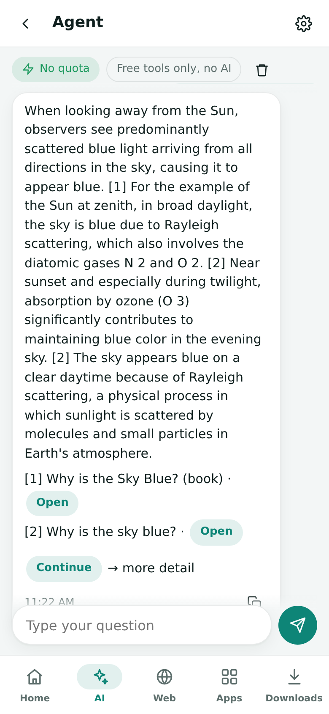
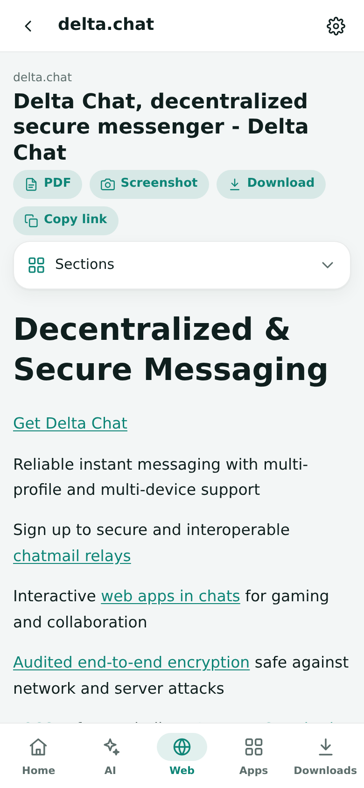
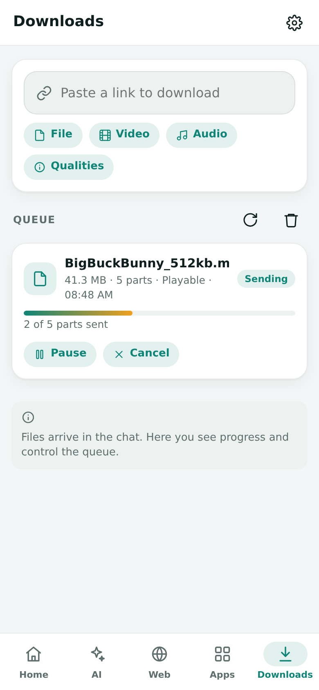
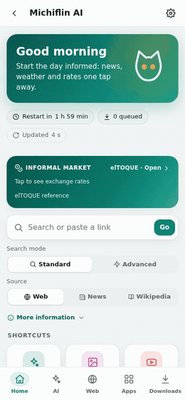

# Michiflin AI

**Your internet over e-mail.** Michiflin AI is a private [Delta Chat](https://delta.chat) bot that searches, reads web pages, answers with free AI models, creates images and downloads files, then delivers everything as small chat messages. It is built for mailboxes with tight quotas and slow, expensive connections.

<p align="center">
  
  
  
  
</p>

<p align="center">
  <a href="docs/GUIDE.md"><b>User guide</b></a> ·
  <a href="README.es.md"><b>Español</b></a>
</p>

## Highlights

- **One mini app for everything.** The bot sends a WebXDC app on first contact, with a short welcome that explains it, and everything happens there: home, AI, web, apps, downloads and settings. A brief introduction runs the first time the app opens. The chat only carries delivered media and files.
- **An agent that needs no AI.** Write normally or paste a link; the agent searches, reads the sources and builds the answer from them, with cited sentences, plus calculator, weather, rates, translation and summaries. It never calls an AI model, so it touches no quota.
- **A bounded AI research agent.** An optional separate agent plans up to four model steps using public search, page reading, weather and calculation. It uses AI quota, treats web pages as untrusted data, and has no shell, private-login, messaging or write tools.
- **Free hosted AI.** Routes across free tiers (Gemini, Groq, Mistral, SambaNova, Z.AI, OpenRouter, Cloudflare, BazaarLink, OrcaRouter, plus the keyless LLM7 and Kilo gateways) with per-model quotas and automatic fallback. SambaNova's documented free-tier caps are tracked conservatively; see [provider notes](docs/AI_PROVIDERS.md). Each model shows why it is paused: limit reached, key rejected or no longer free, and the bot notifies you when a model stops or comes back. Pick the exact image model or let it choose. Each model chat shows its maker's mark and takes the attachments that model can read: photos, PDF and documents, and audio on Gemini.
- **A coding agent.** Describe a program or a web page; free coding models write the files, automatically check Python syntax, JavaScript and C/C++ syntax when the sandbox is available, compile Java when `javac` is installed, and run permitted checks in an isolated sandbox without network or secrets, and fix errors. Review the file-level diff and undo the last project change in the app. Preview web pages inside the app and export Delta Chat mini apps as ready-to-open `.xdc` files named after the project (or the source as a ZIP). Plain questions get an answer instead of a build.
- **Light web browsing.** Pages arrive as a compact text view with tappable links. PDF and sharp screenshots on request. Search the web, news, videos or Wikipedia with the standard engine (no limits), or switch the bar to the advanced engine when you need better results.
- **Downloads for email-based data plans.** Videos, audio and files are split into parts: 10 MB by default for `@nauta.cu`, 20 MB for other addresses, with an automatic smaller-part retry if the provider explicitly rejects the size before any part is delivered. Media links use yt-dlp's extractors for many sites beyond YouTube, plus direct file links; support varies by source, and DRM/private content is not promised. Media parts are playable segments; other files are numbered parts with a checksum. Provider-specific profiles can set stricter verified limits. Downloaded `.xdc` files arrive as mini apps that open in the chat.
- **Private queue.** The production deployment starts owner-only. Only the owner can temporarily authorize specific guests; old access and usage records do not grant access and are not automatically deleted.
- **Join parts on any phone.** A built-in tool puts the parts in order by itself, even if the phone renamed them, verifies them and joins them, including video and audio segments into one playable file.
- **Useful without AI.** Translator, unit converter, local time, weather, headlines, informal exchange rates and a calculator.
- **Private by design.** Owner-only by default, with temporary, individual guest access controlled by the owner and silent blocking of unknown senders. Notes, queued links, account metadata and some temporary files can be retained; AI requests go to a third-party provider under its own privacy terms. Do not include passwords or private keys.
- **Administration.** A live panel shows CPU, memory, disk, network, response times, the queue and the host session, runs a bounded stress test, and displays the owner's usage without deleting historical records belonging to others. Recent warnings and errors have bounded, expandable, best-effort-redacted details.

## The mini app

<p align="center">
  
  
</p>
<p align="center"><sub>Tour (<a href="docs/media/en/clip-tour.mp4">MP4</a>) · Search and read (<a href="docs/media/en/clip-web.mp4">MP4</a>)</sub></p>

The app is sent by the bot and talks to it through WebXDC updates, so it works wherever Delta Chat works, with no internet access of its own.

| Tab | What it does |
|---|---|
| **Home** | Search box, shortcuts, queue status and time until the next server restart |
| **AI** | Agent, automatic model rotation, image studio and one chat per model with remaining uses |
| **Web** | Results from the selected engine, reader view, history, PDF, screenshot and download actions |
| **Apps** | YouTube, translator, rates, weather, news, utilities, status and administration |
| **Downloads** | Download queue plus a separate saved-links section with reader, screenshot and download actions |
| **Settings** | App language and theme, Nauta strict and kill switch, bot settings and data cleanup |

The app follows the device language (Spanish or English) and theme, and adapts from phones to desktop.

## Chat usage

By default the bot works **only through the mini app**. It sends the app automatically when a contact first connects, and any text written in the chat is answered with a pointer to the latest app. `/app` sends a fresh copy at any time. Files sent to the chat (voice notes, photos, documents) are still processed.

Setting `chat` to `full` (or `CHAT_MODE=full` as the default) restores classic chat mode, where every feature is also a bilingual command. The command list is in the [guide](docs/GUIDE.md#classic-chat-mode).

### Settings

The owner can change bot settings in the mini app or with `/settings NAME VALUE` in classic chat mode (Spanish name in parentheses). Production starts owner-only; per-person settings apply to guests only after an explicit controlled authorization.

| Group | Setting | Values |
|---|---|---|
| Downloads | `video` (`video`) | 144–1080 · low · medium · high (default 360) |
| | `audio` (`audio`) | 32–160 kbps · low · medium · high |
| | `format` (`formato`) | m4a · mp3 · opus |
| | `part` (`parte`) | 1–20 MB per part |
| | `packing` (`empaque`) | parts · 7z · zip |
| Delivery | `auto` (`auto`) | yes · no |
| | `batch` (`lote`) | 0 = all · N parts then pause |
| | `delay` (`pausa`) | seconds between parts |
| | `window` (`ventana`) | e.g. 2200-0600 · no |
| | `cap` (`tope`) | MB received per 24 h · 0 = no cap |
| Web | `page` (`pagina`) | 30–900 KB per reader page |
| | `images` (`imagenes`) | no · low |
| | `links` (`enlaces`) | chat · web |
| | `capture` (`captura`) | mobile · desktop |
| | `sharpness` (`nitidez`) | normal · high · max |
| General | `language` (`idioma`) | auto · es · en |
| | `notices` (`avisos`) | minimal · normal |
| | `progress` (`progreso`) | yes · no |
| | `reactions` (`reacciones`) | yes · no · all |
| | `imagesize` (`imagen`) | 512 · 768 · 1024 |
| | `chat` (`chat`) | app · full |
| Server / legacy limits | `jobs` (`trabajos`) | 1–20 downloads at once per person (default 3; administrators are exempt) |
| | `quota` (`cuota`) | MB per person a day · 0 = none; over it, a person is served last |
| | `airequests` (`consultas`) | AI requests per person a day (default 60) · 0 = no limit |
| | `imagesday` (`dibujos`) | images per person a day (default 15) · 0 = no limit |
| | `projects` (`proyectos`) | Coder projects per person a day (default 4) · 0 = no limit |
| | `reserve` (`reserva`) | % of the day's free AI kept for administrators (default 25) · 0 = none |
| | `retention` (`retencion`) | hours to keep finished jobs |

Per-person limits apply to authorized guests when the owner explicitly opens a controlled session; they do not grant access by themselves.

## Configuration

Use `.env.example` as a template for environment variables and export them into the bot process; it does not automatically load `.env`. `OWNER_ADDRESS` is required in owner-only or maintenance mode.

- **Access:** production starts with `OWNER_ONLY=1`: only `OWNER_ADDRESS` is accepted until the owner explicitly opens a temporary session and approves each guest. Old allow-lists are not reactivated. On restart the configured value applies again. `MAINTENANCE_MODE=1` admits only the owner and takes precedence. Missing `OWNER_ADDRESS` fails closed. Historical jobs are not purged or revived. See [session access control](docs/ACCESS_CONTROL.md).
- **Stable identity:** set `BOT_EPOCH` to a stable, private-to-the-deployment opaque identifier. Rotating it invalidates older mini-app instances. If unset in Actions, this deployment uses a fixed fallback derived from its prior root commit, so ordinary code updates do not change the epoch.
- **Safety defaults:** `NAUTA_STRICT` and `KILL_SWITCH` default to `0` when no saved value exists; a saved per-person value takes precedence. Strict Nauta caps parts at 10 MB or the smaller verified mailbox limit. The kill switch blocks new work and cooperatively interrupts active downloads and requests; see its limits below.
- **Owner notice:** `OWNER_NOTICE` (optional) is shown once in the owner's app after the next start; a new text is shown again.
- **AI providers:** one key per provider, all optional: `GEMINI_API_KEY`, `GROQ_API_KEY`, `MISTRAL_API_KEY`, `OPENROUTER_API_KEY`, `ZAI_API_KEY`, `CLOUDFLARE_ACCOUNT_ID` + `CLOUDFLARE_AI_TOKEN`, `GITHUB_MODELS_TOKEN`, `POLLINATIONS_API_KEY`, `BAZAARLINK_API_KEY`, `ORCAROUTER_API_KEY`, `SAMBANOVA_API_KEY`. The bundled catalog selects models labeled free, but provider terms and charges can change; verify your account. LLM7 and Kilo work without a key; their optional free tokens `LLM7_API_KEY` and `KILO_API_KEY` raise the limits, and `FREE_GATEWAYS=0` turns both off.
- **Hosted free-model routing (default):** no model, GPU or inference service is required on the owner's computer. The bot uses configured provider APIs and free-only aggregators; prompts and code are sent to whichever external provider handles a request, so do not include passwords or private keys. Free-tier availability and limits vary. See [provider and privacy notes](docs/AI_PROVIDERS.md).
- **Images:** Cloudflare models, a Hugging Face Space (`HF_TOKEN`, `HF_IMAGE_SPACE`), AI Horde volunteer GPUs (keyless and slower; `AI_HORDE_API_KEY` adds priority, `AI_HORDE=0` disables) and Pollinations (`POLLINATIONS_PUBLIC=0` disables the keyless endpoint). Automatic mode tries them in order; any of them can be chosen by hand.
- **Coder:** project commands run as an unprivileged user in a network-less namespace with CPU, memory and time limits; this needs passwordless `sudo`, `unshare`, `setpriv` and `prlimit`. When toolchains are installed, it checks Python/JavaScript/C/C++ syntax and compiles Java; the agent cannot download dependencies from the isolated sandbox. Without the isolation tools, or with `CODE_RUN=0`, it only writes files.
- **Search:** the standard engine is keyless. `YDC_API_KEY` (optional, `YDC_DAILY` limit) enables the advanced engine.
- **Other services:** `ELTOQUE_API_TOKEN` uses the official elTOQUE API for rates (the public table is read without it). `MICHIFLIN_GITHUB_TOKEN` enables `/github`.
- **Blocked sources:** `MEDIA_PROXY` and `WEB_PROXY` route downloads and pages through a SOCKS or HTTP proxy. `YTDLP_COOKIES` accepts a Netscape cookie file for the owner only; it is not a per-contact login system, so never use it for another person's account. General authenticated browser sessions are not implemented; the optional YouTube API connection below is separate.
- **Optional YouTube account:** a Google device OAuth client plus `GOOGLE_OAUTH_CLIENT_ID`, `GOOGLE_OAUTH_CLIENT_SECRET` and a separate, stable high-entropy `WEB_SESSION_KEY` enable individual, read-only access to a user's own channel and first page of subscriptions. It requires Google's approval and the user's consent; no account is connected by default. Other requested websites are manual links, not connected sessions. See [web access scope](docs/WEB_ACCESS.md).
- **Extra providers:** `EXTRA_PROVIDERS` adds OpenAI-compatible endpoints only when their exact HTTPS hostname is listed in `AI_EXTRA_ALLOWED_HOSTS` (for the example below, `api.example.com`). Redirects are disabled for these custom endpoints; do not list a host unless you trust it with the configured API key. See [provider security and quota notes](docs/AI_PROVIDERS.md).

  ```json
  [{"key": "example", "name": "Example", "base_url": "https://api.example.com/v1",
    "api_key_env": "EXAMPLE_API_KEY", "models": [{"id": "model-name", "roles": ["chat"], "daily": 200}]}]
  ```

- **Chat mode:** `CHAT_MODE` is `app` (mini app only, the default) or `full` (classic commands too).
- **Defaults and limits:** every setting above has an environment default (`DEFAULT_VIDEO_HEIGHT`, `CHUNK_MB`, `READER_PAGE_KB`, `NOTIFY_MODE`…), and `MAX_FILE_MB`, `MAX_QUEUE_MB` and `MIN_FREE_DISK_MB` protect the disk.

The account state (Delta Chat keys, settings, notes and queue metadata) lives in `CONFIG_DIR`. `state_backup.py save|restore` keeps an encrypted copy in a private repository (`STATE_BACKUP_REPO`, `STATE_BACKUP_PASSPHRASE`); larger attachment copies are excluded, not necessarily every conversation or token. Restore only while the bot is stopped and after preserving the current state: restoration runs only when `CONFIG_DIR` is absent and does not automatically overwrite it. Never publish the passphrase or backup token.

## Running

Requirements: Python 3.11+, ffmpeg, 7-Zip (`p7zip-full`) and Chromium for Playwright. Installing deno is recommended for yt-dlp.

```bash
pip install -r requirements.txt
python -m playwright install --with-deps chromium
python bot.py --config-dir ./state init DCACCOUNT:nine.testrun.org
python bot.py --config-dir ./state serve
```

Each session lasts `SESSION_DURATION_SECONDS` (the GitHub Actions deployment uses 19,200 seconds to leave shutdown and backup headroom before its job timeout). The status view shows uptime and the time left until the planned restart, and pending jobs can resume in the next session, but uncertain deliveries pause for review. GitHub Actions is only a temporary host here; its policy and account-suspension risk are not removed by these code changes.

### Emergency pause

Use **Apps → Kill switch** or `/kill_switch yes|no` (also available in app-only chat mode). While on, new work is refused; active downloads and packaging stop at cooperative checkpoints and return to the queue. Turning it off lets queued jobs continue; interrupted AI/agent requests must be retried. A request already sent to a remote provider cannot be recalled, and a network read may take until its timeout to stop. A part already entering the Delta Chat handoff may still be delivered. Delivery intent is recorded before handoff; uncertain outcomes pause instead of being blindly resent. A stale backup or an interruption during transport still cannot guarantee exactly-once delivery: check the chat before retrying. Pending outbox mail is not automatically purged. Inspecting or purging historical state requires the owner's separate permission.

### Reliable delivery

- **Every message is taken exactly once.** Live core events are backed by the core's bot cursor (`get_next_msgs` / `markseen_msgs`) and a small inbox kept in the state, checked every 20 seconds. A message whose event was missed, or that arrived while the bot was offline, is still answered; one interrupted by a crash is run again (at most twice).
- **Per-chat order without blocking.** Each chat has its own queue, so a slow request never holds the threads that serve app updates or other chats.
- **Graceful stop.** On `SIGTERM` or `SIGINT` the bot stops taking new work, lets running requests finish (up to 75 s), waits for outgoing mail to leave and saves the state before closing the core. Unstarted requests stay unread for the next session.
- **Self-update.** The bot checks the deployed branch every five minutes; when a new commit appears and nothing is running, it hands over to a fresh session (the job writes `RESTART_MARKER` and starts the next run).
- **App instances are kept.** History pruning never removes the mini app message, so app requests can always be matched to it.

## Development

```bash
python -m pytest -q tests/
python tests/test_webxdc.py
```

`bot.py` is the entry point and `michiflin/` holds the package:

| Module | Role |
|---|---|
| `agent`, `answer` | Intent routing and the agent's extractive answers |
| `ai` | Providers, models and quotas |
| `web`, `reader`, `browser` | Pages, reader view, PDF and screenshots |
| `media`, `files`, `queue` | Downloads, parts and delivery |
| `commands`, `names` | Chat commands and their names in both languages |
| `miniapp` | WebXDC bridge; the app itself lives in `webxdc/` |
| `admin` | Access control and alerts |
| `usage`, `perf` | Fair-share accounting, server metrics and the stress test |
| `extras`, `tools` | Translator, converter, weather, rates and search |

## Privacy

Account state and encrypted backups can contain contact and message metadata, notes, queued links, settings, job metadata and small attachment copies. Download parts can remain in temporary job storage for retries until cleanup or disk pressure. In private mode old local message history, temporary files and non-owner jobs are retained rather than automatically purged, so disk use can grow. Usage totals are kept per address. AI conversations on the device and prompts sent to providers follow their own retention rules. Treat the state, backups and logs as sensitive.

## Temporary hosting and backups

The current GitHub Actions deployment is temporary. GitHub says hosted Actions should be related to producing, testing, deploying, or publishing the repository software; using it as a permanent server risks restrictions or account suspension. The 19,200-second session leaves time for orderly shutdown and backup but does not remove that policy risk. The workflow is configured to fail closed if the established encrypted state backup is missing, rather than silently creating a new account. New encrypted backups append commits without force-updating the private branch; history and repository storage can grow, so monitor usage and obtain the owner's permission before removing old copies.

## License

All rights reserved. The code is published for reading and learning only; running it for others or redistributing it requires permission. See [LICENSE](LICENSE).
